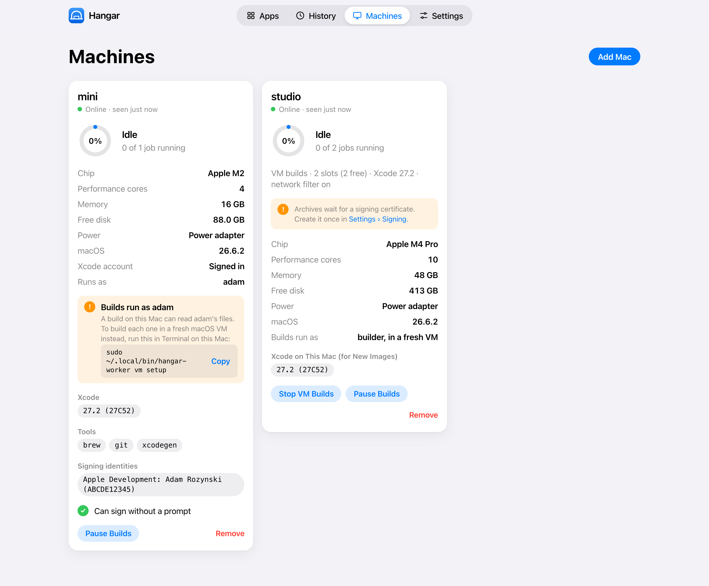

# Hangar

**Your own Xcode Cloud, on Macs you already have.**

Hangar builds, tests and ships Apple apps on your own Macs. It runs the same `ci_scripts/` you wrote for Xcode Cloud, archives your schemes, uploads them to TestFlight or exports them with Developer ID, and shows every build live in a web UI. By default each build runs in a fresh macOS VM, so builds start clean and can't see the rest of your Mac.



## Why

Xcode Cloud is convenient until you hit its compute-hour limits, wait in its queue, or need a tool its image doesn't have. Hangar keeps the convenience and moves the work to hardware you own:

- **Bring your existing setup.** `ci_post_clone.sh`, `ci_pre_xcodebuild.sh` and `ci_post_xcodebuild.sh` run unchanged, with the `CI_*` variables they expect, plus `CI_HANGAR=TRUE` so a script can tell the two apart.
- **Clean builds, isolated from your files.** Every job gets its own VM, cloned from an image that holds only macOS and Xcode. It boots in seconds, can't reach your Mac or your network, and is deleted when the job ends. A job that needs Homebrew installs it, just as it would on Xcode Cloud.
- **Ship straight to testers.** TestFlight uploads, with processing tracked, testers added to groups, "What to Test" notes and beta review submission. Developer ID exports for apps outside the App Store.
- **Build numbers that never collide.** The next number is one higher than anything Hangar, App Store Connect or Xcode Cloud knows about, so you can run both side by side.
- **Built for agents too.** A scoped `hangar mcp` server lets AI agents deploy, read logs and check builds without ever seeing a secret.

## How it works

```
                 tailnet
┌────────────────┐        ┌─────────────────────────────┐
│ hangar-server  │◀──────▶│ hangar-worker  (each Mac)    │
│ web UI · API   │        │  ├─ VM mode: a fresh macOS   │
│ secrets · jobs │        │  │  VM per job (default)     │
└────────────────┘        │  └─ local mode: on the Mac   │
        ▲                 └─────────────────────────────┘
        │
  browser · hangar CLI · hangar mcp
```

- **`hangar-server`** runs on one always-on Mac. It stores apps, workflows, build history and encrypted secrets, schedules jobs across your Macs, and serves the web UI and HTTP API. It is only reachable on your [Tailscale](https://tailscale.com) network, where your own devices are recognised as you.
- **`hangar-worker`** runs on each build Mac and keeps itself up to date. It builds in one of two modes:
  - **VM:** one macOS VM per job, through Apple's Virtualization framework. This is the default on Apple silicon. Signing happens inside the VM with a development certificate Hangar manages; the App Store Connect key stays on the host, which does the export and upload.
  - **Local:** directly on the Mac, as you. Fast and simple, with warm caches.
- **`hangar`** is the command-line client, and **`hangar mcp`** is the MCP server for agents.

Workers clean up after themselves: per-job files, old VM images, unused workspaces and old build artifacts are swept automatically.

## Getting started

You need macOS 15 or later, Xcode, and Tailscale on every Mac. Apple silicon is required for VM builds.

1. **Install the server** on the always-on Mac:

   ```sh
   git clone https://github.com/rurza/hangar.git && cd hangar
   scripts/server/install-server.sh --bin-dir ~/.local/bin
   ```

2. **Open the web UI** at `http://<server>:8787` and follow the setup page. It asks for an App Store Connect team key and a GitHub token; then create the signing certificate VMs use in **Settings › Signing**.

3. **Add a Mac.** In **Machines › Add Mac**, run the command shown on the build Mac and type the pairing code:

   ```sh
   curl -fsSL http://<server>:8787/install | sh
   ```

   Choose VM builds, and the installer sets up everything in one `sudo` step: the network filter that keeps VMs off your network, and a VM image with your Xcode.

4. **Add an app and deploy.** Pick the repository, let Hangar suggest a workflow from your project (or keep a [`.hangar.yml`](docs/hangar-yml.md) in the repo), and press Deploy.

Everything in the web UI is also available from the command line:

```sh
export HANGAR_SERVER=http://<server>:8787
hangar deploy my-app Beta --ref main
hangar status
hangar logs <build-id> --follow
```

## Documentation

- [Server setup](docs/server-setup.md)
- [Worker setup](docs/worker-setup.md), including VM builds and disk use
- [`.hangar.yml` reference](docs/hangar-yml.md)
- [HTTP API](docs/api.md)
- [MCP access for AI agents](docs/mcp.md)
- [Claude Code plugin](plugins/hangar/README.md)
- Design notes in [`docs/superpowers/specs`](docs/superpowers/specs)

## Building from source

```sh
swift build
swift test
```

Hangar is written in Swift 6. The server uses [Hummingbird](https://github.com/hummingbird-project/hummingbird) and [GRDB](https://github.com/groue/GRDB.swift), and the web UI is plain JavaScript modules with no build step.

## Status

Hangar is young and moves fast. It builds and ships several apps every day, to TestFlight and with Developer ID, but expect rough edges and breaking changes between versions.

## License

Hangar is free software, licensed under the [GNU Affero General Public License v3.0](LICENSE). If you run a modified Hangar as a service for others, the AGPL requires you to share your changes with them.
